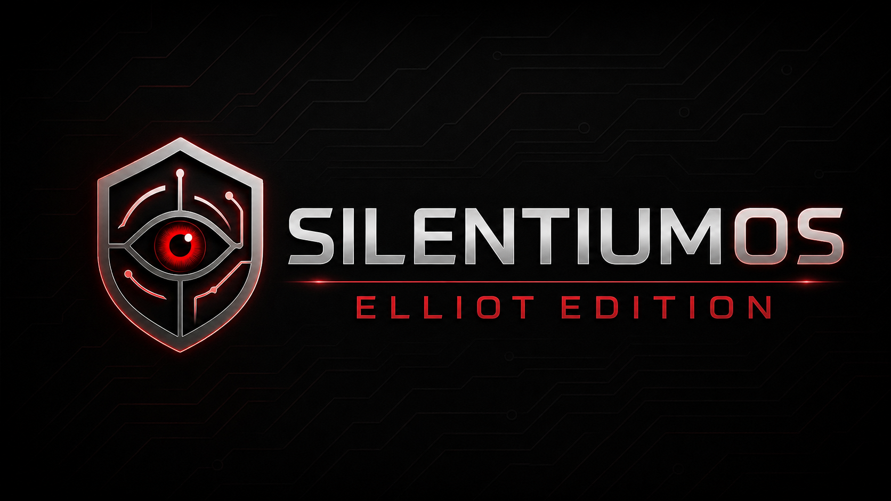
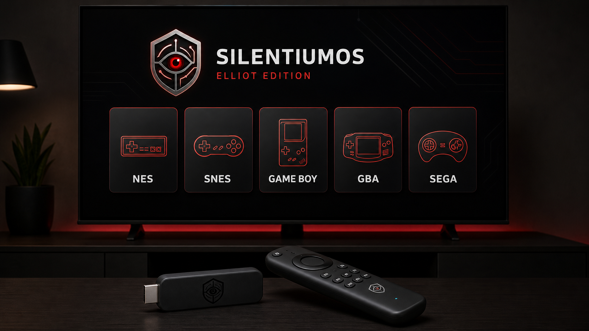
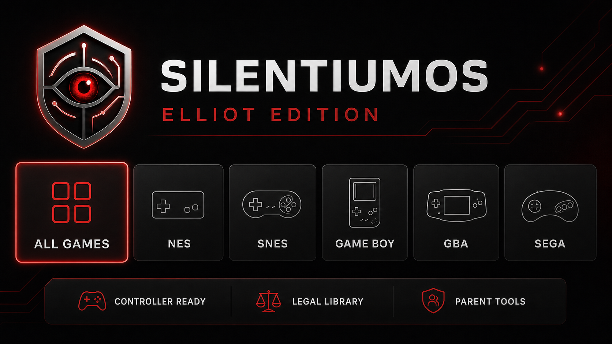
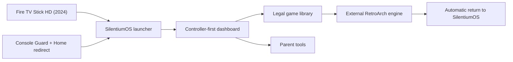

<p align="center">
  
</p>

# SilentiumOS — Elliot Edition

SilentiumOS — Elliot Edition is a television-first Android launcher and legal-homebrew library manager built by **Silentium Labs** for a 2024-class Fire TV Stick HD.

It combines a controller-friendly dashboard, parent tools, boot startup, guarded navigation, RetroArch launch integration, and a test-first workflow for legally redistributable games.

<p align="center">
  
</p>

> **Concept visualization:** the image above is an original product mockup showing the intended hardware and interface experience. It is not a retailer photograph, a claim of Amazon endorsement, or a substitute for a sanitized on-device verification capture.

## At a glance

| Area | Public snapshot |
| --- | --- |
| Platform | Fire OS 7 / Android 9 / API 28 class hardware |
| Primary target | Fire TV Stick HD with Alexa Voice Remote (2024), 32-bit ABI |
| Interface | 10-foot television UI with controller navigation |
| Library policy | Homebrew, open-source, public-domain, or otherwise authorized games only |
| Emulator relationship | Launch integration only; RetroArch APKs and cores are not distributed here |
| Security posture | No production PIN, signing keys, private network data, device IDs, ROMs, APKs, logs, or caches |
| Release type | Public source-available portfolio snapshot |

## Hardware target

This Android project targets the **2024 Fire TV Stick HD with Alexa Voice Remote**, which Amazon documents as Fire OS 7 / Android 9 (API 28), 32-bit, and capable of Full HD output. Amazon's newer **2026 Fire TV Stick HD uses Vega OS** and is not compatible with this Android source as-is.

See [Device concept and compatibility](docs/DEVICE_CONCEPT.md) for the support matrix and the official Amazon device-specification source.

## Current interface concept

<p align="center">
  
</p>

The screen is a presentation mockup derived from the implemented dashboard structure. It intentionally contains no device status, accounts, addresses, serial numbers, copyrighted game art, or private library data.

## Features

- Full-screen living-room dashboard
- Large, controller-focused system and library tiles
- Child-facing Back-navigation protection
- Parent tools protected by an explicitly configured four-digit PIN
- PIN stored in the generated build configuration as a SHA-256 digest rather than plaintext
- Accessibility-based Home redirect for locked Fire OS builds
- Foreground Console Guard service
- Boot receiver and startup splash
- System and **All Games** views
- Bounded, canonical-path-checked local library discovery
- Dependency-free Java catalog contract tests
- Direct RetroArch core and ROM launch intents
- Controller shortcut support for returning from games
- Legal-library collection, filtering, structural validation, and hardware smoke testing
- Safe hash-based temporary ROM paths for ADB testing
- Automatic restoration of console mode after controlled tests
- Public-release audit script and GitHub Actions safety gate

## Architecture



SilentiumOS runs **on top of Fire OS**. It is not replacement firmware, does not unlock the bootloader, and does not remove Amazon's protected system launcher.

## Repository layout

```text
app/                 Android TV launcher source
scripts/             Build, release-audit, and target examples
tools/               Legal-library and console-mode utilities
tests/               Public audit and pure Java contract tests
docs/assets/         Public branding and product-concept images
docs/screenshots/    Sanitized interface concepts and future device captures
docs/                Architecture, security, testing, legal, and roadmap notes
.github/              Public-safety automation and contribution templates
```

## Build securely

The repository has **no default parent PIN**. Every build must receive a private four-digit value through a local environment variable or Gradle property:

```powershell
$securePin = Read-Host "Private four-digit parent PIN" -AsSecureString
$env:SILENTIUM_PARENT_PIN = (New-Object System.Net.NetworkCredential("", $securePin)).Password
gradle clean :app:assembleDebug
Remove-Item Env:SILENTIUM_PARENT_PIN
Remove-Variable securePin
```

The value is hashed during Gradle configuration and is not written into the repository. A four-digit parental gate is not high-assurance cryptography; it is intended to separate child and parent controls on a managed household device.

## Connect a test device

Public tools do not contain a target address. Set a hostname or authorized ADB destination only in your local shell:

```powershell
$env:SILENTIUM_TARGET = "fire-tv-hostname.local:5555"
python tools/enable_console_mode.py
Remove-Item Env:SILENTIUM_TARGET
```

Never commit a private IP address, device serial, MAC address, household network name, account identifier, or local path.

## Public-release safety check

Run the same repository audit used by CI before committing:

```powershell
powershell -NoProfile -ExecutionPolicy Bypass -File .\scripts\audit-public-release.ps1
```

Or run the standard-library Python version on any supported desktop platform:

```text
python tools/audit_public_release.py .
python -m unittest discover -s tests -v
```

The checks block prohibited binary formats, sensitive directories, symlinks, oversized files, and manifest drift. They scan public text for private network addresses, MAC addresses, local user paths, private-key headers, common provider token formats, hardcoded secrets, and hardcoded PIN values.

See [Security audit](docs/SECURITY_AUDIT.md), [Privacy model](docs/PRIVACY.md), and [Security policy](SECURITY.md).

## Legal game policy

SilentiumOS does not ship commercial ROMs, BIOS files, emulator cores, or APKs. Library tools are intended only for:

- Homebrew released for free redistribution
- Open-source games
- Public-domain games
- Games the user is legally permitted to copy and use

See [Legal library policy](docs/LEGAL_LIBRARY.md).

## Documentation

- [Architecture](docs/ARCHITECTURE.md)
- [Development guide](docs/DEVELOPMENT.md)
- [Architecture decisions](docs/decisions/README.md)
- [Release checklist](RELEASE_CHECKLIST.md)
- [Device concept and compatibility](docs/DEVICE_CONCEPT.md)
- [Testing guide](docs/TESTING.md)
- [Security audit](docs/SECURITY_AUDIT.md)
- [Privacy model](docs/PRIVACY.md)
- [Brand guide](docs/BRAND_GUIDE.md)
- [Roadmap](docs/ROADMAP.md)
- [Fire OS limitations](docs/FIRE_OS_LIMITATIONS.md)
- [Screenshot policy](docs/SCREENSHOTS.md)

## Project status

The 0.7.7 public snapshot adds a bounded, testable game-catalog layer and expands automated source-safety checks. The latest documented manual proof confirmed that RetroArch stayed foregrounded and that the requested FCEUmm core was mapped into the running RetroArch process. Repository visuals remain explicitly labeled concepts until clean on-device captures can replace them.

## License and trademarks

Copyright © 2026 Silentium Labs. All rights reserved. No open-source license is granted. See [LICENSE.md](LICENSE.md).

Amazon, Fire TV, Fire OS, Alexa, RetroArch, libretro, and other third-party names belong to their respective owners. SilentiumOS is an independent project and is not affiliated with or endorsed by Amazon or the RetroArch/libretro projects. See [NOTICE.md](NOTICE.md).

Security reports: **silentiumlabsio@gmail.com**

Made for Elliot. Built by Silentium Labs.
