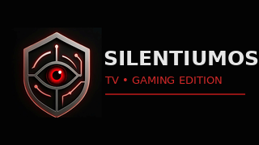
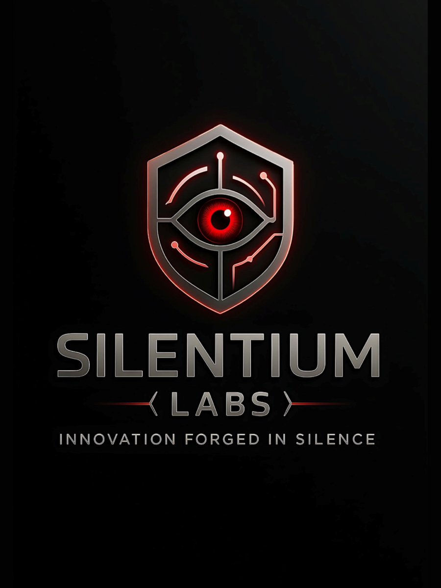

<p align="center">
  
</p>

# SilentiumOS — Elliot Edition

SilentiumOS — Elliot Edition is a television-first Android launcher and legal-homebrew game library manager built by **Silentium Labs** for a Fire TV device.

It provides a controller-friendly dashboard, system categories, parent tools, RetroArch launch integration, automatic return behavior, boot startup, and a test-first legal game-library workflow.

> This repository is a public, sanitized source snapshot. It does not contain ROMs, BIOS files, emulator cores, RetroArch APKs, signing keys, private device addresses, or the production parent PIN.

## What it is

SilentiumOS runs **on top of Fire OS**. It is not replacement firmware and does not unlock or replace the Fire TV bootloader.

The project currently targets:

- Android 9 / API 28-class Fire TV devices
- 32-bit RetroArch RA32
- Gamepad and television navigation
- NES, SNES, Game Boy / Game Boy Color, GBA, Mega Drive / Genesis, and Master System homebrew
- Optional no-content libretro games such as 2048, Mr. Boom, and Craft

## Current features

- Full-screen television dashboard
- Child-facing Back navigation protection
- Accessibility-based Home redirect on locked Fire OS builds
- Foreground Console Guard service
- Boot receiver and startup splash
- Parent tools protected by a configurable four-digit PIN
- System and “All Games” views
- Direct RetroArch core and ROM launching
- Controller shortcut support for returning from games
- Legal-library collection, filtering, structural validation, and hardware smoke testing
- Safe hash-based temporary ROM paths for ADB testing
- Automatic restoration of console mode after tests

## Screens and branding

<p align="center">
  
  &nbsp;&nbsp;&nbsp;
  
</p>

Actual device screenshots are intentionally not included yet because the available uploads contained private LAN/device information or build logs rather than clean dashboard captures. Sanitized screenshots can be added under `docs/screenshots/`.

## Repository layout

```text
app/                 Android TV launcher source
scripts/             Public build and target examples
tools/               Sanitized library and console-mode utilities
docs/assets/         Public branding images
docs/                Architecture, legal-library, and security notes
```

## Building

Open the repository in Android Studio with Android SDK 36 installed, or use a compatible Gradle installation.

The default public parent PIN is `0000`. Set a private PIN at build time:

```powershell
$env:SILENTIUM_PARENT_PIN = "1234"
gradle clean :app:assembleDebug
```

Do not commit the real production PIN.

## Device target

Public tools read the Fire TV ADB destination from `SILENTIUM_TARGET`:

```powershell
$env:SILENTIUM_TARGET = "fire-tv-hostname.local:5555"
python tools/enable_console_mode.py
```

Never commit a private device address, serial number, MAC address, or household network information.

## Legal game policy

SilentiumOS does not ship commercial ROMs. Library tools are designed for:

- Homebrew released for free redistribution
- Open-source games
- Public-domain games
- Games the user is legally permitted to copy and use

See [`docs/LEGAL_LIBRARY.md`](docs/LEGAL_LIBRARY.md).

## Fire OS limitation

Amazon launcher packages are protected on the tested Fire OS build. SilentiumOS therefore uses an accessibility redirect and guard service rather than claiming to replace protected system firmware. A brief Amazon Home flash may occur.

## Status

The source snapshot reflects the 0.7.5 safe-path test architecture. The latest verified manual proof confirmed that RetroArch stayed foregrounded and the requested FCEUmm core was mapped into the running RetroArch process.

## License

Copyright © 2026 Silentium Labs. All rights reserved.

The repository is public for portfolio, review, and educational visibility. No open-source license is granted. See [`LICENSE.md`](LICENSE.md).

## Contact

Security reports: **silentiumlabsio@gmail.com**

Made for Elliot. Built by Silentium Labs.
